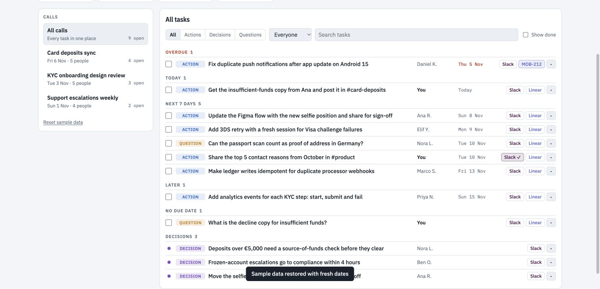

# Call Task Hub

**Browser:** usable local demo. **Claude artifact:** optional AI extraction. **Slack/Linear integrations:** simulated in the app.

## Try it

1. Open `index.html` in a browser. It starts with fictional calls and tasks.
2. Use **Add transcript**, supply speaker-labelled lines, the meeting date, and your name.
3. Extract locally, review owners and dates, and edit the results.
4. Open a Slack or Linear composer to draft and copy text. Send/create buttons change the local demo state only.

For a reproducible extraction example, see [the fixture](../../examples/call-task-hub.json). Data is saved in this browser's local storage.

## Optional Claude artifact

Supply this HTML file to a Claude host that can create artifacts and request the `sample` capability. When granted, the app exposes **Extract with Claude** and acceptance-criteria drafting. These capabilities are host-dependent and have not been exercised in the validation record.

Publishing the artifact does not make Slack or Linear buttons live. For real handoffs, use the [companion skill](../../skills/call-task-hub/SKILL.md) with connected tools and review the proposed text and destination.

## Limitations and validation

Keyword extraction recognises a limited set of English phrases and speaker-labelled lines. It can miss implied actions and must be reviewed. Demo ticket identifiers are invented. Local data has no team sync or server backup.

Automated checks cover relative dates, decisions without due dates, and negative statements; browser smoke checks are recorded in [validation](../../docs/validation.md).
