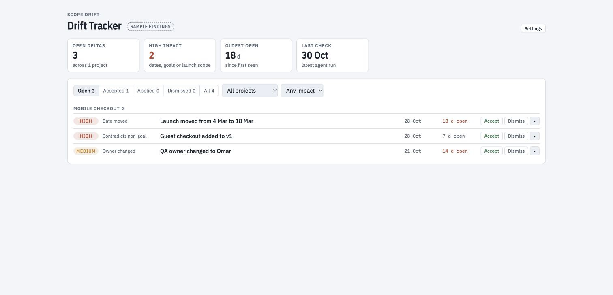

# Drift Tracker

**Browser:** sample findings. **Claude artifact:** implemented Notion connector path. **Live status updates:** require the artifact's `mcp` capability and a compatible Notion connector; not verified end to end.

## Try the sample

Open `index.html` in a browser. Filter the fictional findings, expand a row, and try a review status. Sample changes stay in the current page; findings are not persisted as a local database.

## Connect a findings database

1. Run the [scope drift agent](../../agents/scope-drift-checker.md) with scope, meeting notes, and a findings destination. Its **Findings database** section defines the exact Notion properties.
2. Supply the HTML file to a host that can create Claude artifacts. Request `mcp` access to the Notion server.
3. In **Settings**, paste the findings database link and connect it. The code expects the tool names `notion-fetch`, `notion-query-data-sources`, and `notion-update-page` on server `Notion`.
4. Check that the sample indicator disappears and that a real finding matches its source row before reviewing its status.

If those tools or permissions differ in your host, the adapter needs updating. A database link alone does not grant access.

## Limitations and validation

The app reviews stored findings; it does not detect scope drift or edit scope documents. Connected status changes write to Notion. The query requests at most 100 rows, with no pagination implemented. Source-link lookup and property parsing depend on the connector's returned format.

The browser sample and disconnected behaviour are covered by manual smoke checks. Notion reads, status writes, and agent-to-app handoff remain unverified; see [validation](../../docs/validation.md).
