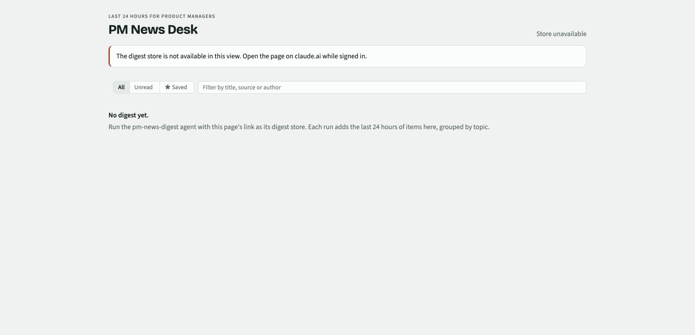

# PM News Desk

**Browser:** store-unavailable state. **Claude artifact:** database-backed news reader. **Live content:** requires the news agent to populate the same artifact store; not verified end to end.

## Set up

1. Supply `index.html` to a host that can create Claude artifacts and request `db` and `user` capabilities.
2. Open the published artifact while signed in. An empty store is expected until a digest is written.
3. Run the [PM news agent](../../agents/pm-news-digest.md), supplying this artifact's link as **Digest store**. The runner must have the `ArtifactData` write tool; a plain Claude Code session is not assumed to have it.
4. Confirm a run record and its items appear. Verify a source link before setting up a recurring run.

Without store access, the app displays **Store unavailable**. It has no local news-fetching fallback and does not generate articles. It stores per-user read marks and favourites when user identity is available.

## Data contract

The agent defines `items/<id>` and `runs/<runId>`. The app reads those collections and stores reader marks beneath `data/users/<uid>`. Initial queries request up to 60 runs and 1,000 items. `runId` associates an item with a run; the current agent retains an existing item's original run ID, so a repeat story stays associated with its first run.

## Limitations and validation

Sources can be blocked or outside the time window; an empty run is valid. The agent records blocked sources rather than filling gaps from memory. It writes the report in chat when no store is supplied. Installing an agent does not schedule it or grant artifact-store access.

The disconnected browser state is smoke-checked. Artifact database access, reader marks, and agent writes remain unverified; see [validation](../../docs/validation.md). The screenshot shows the actual disconnected state rather than invented live news.
